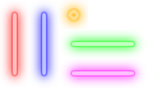

<p align="center">
  
  <h1 align="center">VortexPong</h1>
</p>

<p align="center">
  
  
  <a href="https://github.com/jose-cassios/PythonLab/blob/main/LICENSE">
    
  </a>
</p>

---

## 📖 About

**VortexPong** is a modern and minimalist take on the classic Pong game, developed with Python and the Pygame library. It offers a simple yet engaging two-player experience with custom visuals and sounds.

## ✨ Features

*   **Two-Player Mode:** Play with a friend on the same keyboard.
*   **Custom Sprites:** Unique paddles and ball with a distinct visual style.
*   **Sound Effects:** Immersive sound effects for collisions and scoring.
*   **Resizable Window:** Adjust the game window to your preferred size.

## 🕹️ How to Play

*   **Player 1 (Left Paddle):**
    *   `W`: Move Up
    *   `S`: Move Down
*   **Player 2 (Right Paddle):**
    *   `Arrow Up`: Move Up
    *   `Arrow Down`: Move Down

The objective is to hit the ball with your paddle and score by getting it past your opponent's paddle.

## 🚀 Getting Started

To run VortexPong on your local machine, follow these simple steps.

### Prerequisites

Make sure you have Python 3.8 or higher installed.

### Installation

1.  **Clone the repository:**
    ```sh
    git clone https://github.com/jose-cassios/VortexPong.git
    cd VortexPong 
    ```
2.  **Install the dependencies:**
    ```sh
    pip install pygame
    ```
3.  **Run the game:**
    ```sh
    python src/main.py
    ```

## 🔮 Future Improvements

VortexPong is an evolving project. Here are some features planned for the future:

*   **Power-Ups:** Introduce special abilities to make the gameplay more dynamic.
*   **Story Mode:** A narrative-driven campaign with unique challenges.
*   **Levels:** Different stages with varying difficulty and obstacles.
*   **AI Opponent:** A single-player mode against a computer-controlled opponent.

## 🙏 Credits

This project was created by [José Cássios](https://github.com/jose-cassios).
